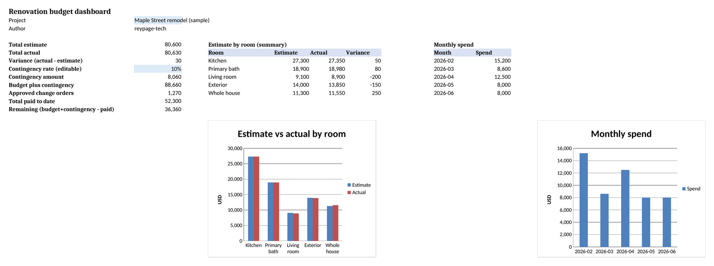
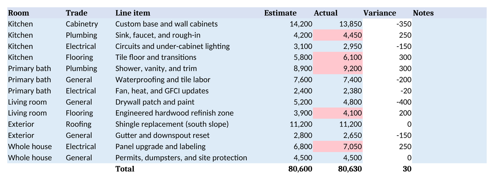
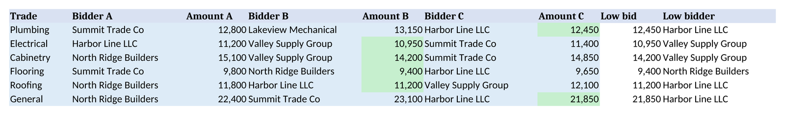

# gas-renovation-budget-sample

Turns matching each room's estimated budget against actual spend by hand into one sheet that shows the variance and any overrun by line item.



Mock output from local tests with fictional data, not a live client project.

A renovation and construction budget tracker for Google Sheets, with a matching Excel workbook export, for contractors and homeowners tracking a remodel's estimate, actual spend, bids, change orders, and draws in one workbook. All figures are fictional for a sample project named **Maple Street remodel (sample)**.

## What you get

- **Executive Dashboard**: KPIs, room summary, monthly spend (on-dashboard), and charts
- **Line-Item Budget & Actuals**: estimate, actual, variance, overrun highlighting
- **Contractor Bid Leveling**: three bids per trade with lowest bid highlighted
- **Contingency & Change Order Log**: change orders and status lists
- **Draws & Milestone Payments**: milestone draws plus payment log on one tab
- Hidden **Lists** tab for validation lists
- Formula cells locked; editable inputs use light blue fill (`#DDEBF7`) under sheet protection (no password)

## Google Sheets: import and share

### Option A: Upload the Excel sample

1. In Google Drive, choose **New → File upload** and select `dist/renovation_budget_sample.xlsx` (build it first; see below).
2. Open the uploaded file in Google Sheets (**Open with → Google Sheets** if prompted).
3. Confirm tab names match the list above and that formulas recalculate without `#REF` / `#NAME` errors.

### Option B: Apps Script setup (recreates the workbook from sample JSON)

1. Create a blank spreadsheet.
2. Open **Extensions → Apps Script**.
3. Paste `src/Code.gs` and add `src/appsscript.json` settings (time zone `America/New_York`, runtime V8).
4. Run **setupWorkbook** once (accept permissions).
5. Use the **Renovation Budget** menu for setup and overrun highlighting.

On edit, the script runs **highlightOverruns_**. Dashboard and budget formulas use **SUMIFS**, **INDEX**/**MATCH**, and **MIN** (no **XLOOKUP** or **FILTER** in the shipped template).

Sample numbers come from `sample_data/sample.json`, embedded into `Code.gs` when you run `build_xlsx.py`.

### Make a “anyone with the link can copy” URL

After the spreadsheet is in Drive:

1. Click **Share**.
2. Set general access to **Anyone with the link** (Viewer is enough for a template users will copy).
3. Copy the normal edit URL, then change the path so it ends with **`/copy`** instead of **`/edit`** (same document ID in the middle of the URL).

Placeholder for your published template:

`COPY_LINK_HERE`

Recipients open that link and click **Make a copy** to get their own editable workbook.

## Excel

Open `dist/renovation_budget_sample.xlsx` (build it first; see below). Formulas use **SUMIFS**, **INDEX**/**MATCH**, and **MIN** for bids. Conditional formatting marks actual over estimate in red on the budget sheet.

## Sheets

| Tab | Purpose |
|-----|---------|
| Executive Dashboard | KPIs, room summary, monthly spend, charts |
| Line-Item Budget & Actuals | Line items, variance formulas, overrun formatting |
| Contractor Bid Leveling | Three bids per trade, low bid and bidder |
| Contingency & Change Order Log | Change-order log with status lists |
| Draws & Milestone Payments | Draw milestones and payment log |
| Lists (hidden) | Rooms, trades, statuses, vendors for validation |

## Build and test

Requirements: Python 3 with **openpyxl**, Node.js (tests only, no npm deps).

```bash
pip install -r requirements.txt
python3 build_xlsx.py
python3 test/test_xlsx.py
node test/run.js
```

`build_xlsx.py` writes `dist/renovation_budget_sample.xlsx` and refreshes the JSON payload inside `src/Code.gs`.

## License

Sample template for demonstration. Adapt for your own projects.

## Screenshots

These are static renders of sheets from the locally built `dist/renovation_budget_sample.xlsx`, not a recording from a real Google account. Separately, `test/test_xlsx.py` rebuilds the workbook, opens a copy with LibreOffice headless to recalculate every formula, and fails if any cell holds a `#REF`, `#NAME`, or other error value.



